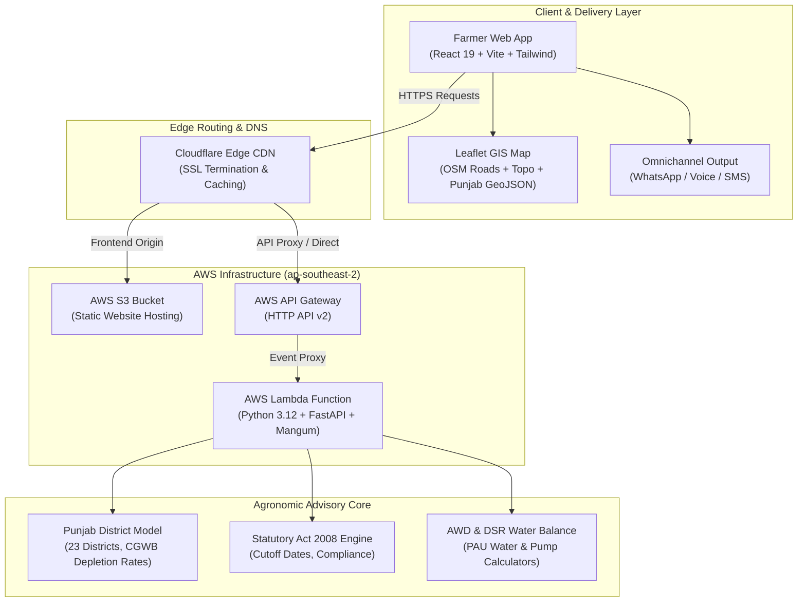

# JalFaasla (ਜਲ ਫ਼ਾਸਲਾ)
### Punjab Groundwater-Aware Crop & Irrigation Advisory Engine

[](https://jalfaasla.abhinavkumarsingh.tech/)
[](https://ofkasl4fri.execute-api.ap-southeast-2.amazonaws.com/health)
[](https://www.python.org/)
[](https://react.dev/)
[](https://fastapi.tiangolo.com/)
[](#test-suite)
[](LICENSE)

> **"Don't just say 'save water.' Tell a farmer: on your plot, delaying transplanting to the notified date and using alternate wetting-and-drying saves tube-well hours and ₹ electricity/diesel costs this season."**

---

## 📌 Live Deployments & Endpoints

| Resource | URL | Infrastructure & Provider |
| :--- | :--- | :--- |
| **Production Web App** | [https://jalfaasla.abhinavkumarsingh.tech/](https://jalfaasla.abhinavkumarsingh.tech/) | Cloudflare Edge CDN + AWS S3 Static Website Hosting |
| **Serverless Backend API** | [https://ofkasl4fri.execute-api.ap-southeast-2.amazonaws.com](https://ofkasl4fri.execute-api.ap-southeast-2.amazonaws.com) | AWS API Gateway HTTP API + AWS Lambda (Python 3.12) |
| **API Health Probe** | [https://ofkasl4fri.execute-api.ap-southeast-2.amazonaws.com/health](https://ofkasl4fri.execute-api.ap-southeast-2.amazonaws.com/health) | Returns JSON status, active region, and system uptime |
| **S3 Storage Bucket** | `s3://jalfaasla.abhinavkumarsingh.tech` | AWS S3 (`ap-southeast-2`) |

---

## 🌊 The Punjab Groundwater Crisis

Punjab produces ~12% of India's rice and ~18% of its wheat, acting as the bedrock of national food security. However, this production is fueled by unprecedented groundwater exploitation:

* **Over-Exploited Blocks:** According to the **Central Ground Water Board (CGWB)**, **114 out of 150 administrative blocks (76%)** in Punjab are categorized as *Over-Exploited* (groundwater draft exceeds annual extractable recharge).
* **The Pumping Trap:** The combination of free agricultural electricity and intensive paddy monoculture has forced tube-well depths from **30 feet in the 1970s to over 300–450 feet today**.
* **Rate of Depletion:** In central districts like Sangrur, Patiala, Ludhiana, and Moga, water tables decline by **50 to 90 cm every single year**, forcing farmers into debt spirals to install high-horsepower submersible pumps (15–25 HP).
* **Pre-Monsoon Evaporative Penalty:** Transplanting paddy in May or early June subjects crops to atmospheric vapor pressure deficits exceeding **3.5 kPa**, with reference evapotranspiration ($ET_0$) peaking at **8–10 mm/day**. Puddling in May requires up to **4,500–5,000 liters of water per kg of rice**, compared to **2,800–3,200 liters** when transplanted after monsoon arrival in late June.

### The Policy Lever: Punjab Preservation of Subsoil Water Act, 2008
Under the **Punjab Preservation of Subsoil Water Act, 2008**, the State Government notifies statutory cutoff dates (historically June 10, then June 20, now June 15–20 varying by zone) before which nursery sowing and field transplanting of paddy is prohibited by law. 

**JalFaasla** translates this statutory regulation and PAU (Punjab Agricultural University) agronomy into **quantified, farm-specific unit economics**.

---

## 💡 What JalFaasla Does

Abstract environmental slogans fail to alter agricultural practices. JalFaasla bridges the gap by computing tangible, plot-level operational metrics:

1. **⏱️ Quantified Tube-Well Hours:** Computes the exact pump operating hours eliminated per season based on plot size, dynamic head, and irrigation scheduling.
2. **💰 Financial & Energy Savings:** Calculates the real financial equivalent saved (both subsidized electricity tariff value and diesel generator fuel expenditure).
3. **🌾 Multi-Pathway Agronomic Evaluation:**
   * **Conventional PTR (Puddled Transplanted Rice):** Pre-notified baseline.
   * **Timely Statutory PTR:** Transplanting aligned with the June 15/20 notification, cutting early-season peak $ET_0$.
   * **AWD (Alternate Wetting and Drying):** Utilizing field water tubes (pani pipe) to irrigate 2–3 days after ponded water recedes, slashing 25–30% water volume with zero yield compromise.
   * **DSR (Tar-Wattar Direct Seeded Rice):** Eliminating puddling entirely, reducing groundwater withdrawal by 15–20%.
   * **Kharif Crop Diversification:** Comparing high-value, low-water alternatives (Basmati 1509/1121, Maize/Corn, Moong/Green Gram, Cotton, Soybean).
4. **🗺️ Interactive GIS Spatial Intelligence:**
   * Official district boundaries GeoJSON covering all 23 Punjab districts.
   * Dual map modes: **Standard Road Map** and **Topographic Terrain** (OpenStreetMap + OpenTopoMap).
   * Visual hydrological network showing the Sutlej, Beas, and Ravi rivers.
   * District-level groundwater vulnerability color coding (Over-Exploited, Critical, Semi-Critical, Safe).
5. **📲 Omnichannel Last-Mile Farmer Delivery:**
   * **WhatsApp Direct Dispatch:** Generates pre-formatted Gurmukhi & English advisory text ready to share with farm clusters.
   * **Interactive Voice Advisory:** Native Web Speech synthesizer voicing real-time advisories in Punjabi and Hindi for low-literacy farmers.
   * **Kisan SMS Gateway:** Compact 160-character cellular SMS format for low-bandwidth feature phones.
   * **Field Summary Card:** Print/PDF-ready agronomic card for Krishi Vigyan Kendras (KVKs) and extension workers.

---

## 🧮 Agronomic & Hydrological Engine: Mathematical Formulas

### 1. Crop Evapotranspiration ($ET_c$)
Water consumption is modeled using the FAO-56 Penman-Monteith dual crop coefficient method:
$$ET_c = ET_0 	imes K_c$$

* $ET_0$: Daily reference evapotranspiration (May–June: $8.5 	ext{ mm/day}$; July–August: $4.8 	ext{ mm/day}$; September: $3.8 	ext{ mm/day}$).
* $K_c$: Crop coefficient (Paddy initial: $1.05$; mid-season: $1.20$; late: $0.90$).

By shifting transplanting from May 25 to June 20, the crop bypasses 26 days of peak $ET_0$, saving:
$$\Delta W_{\text{evap}} = \sum_{t=\text{May 25}}^{\text{June 20}} ET_{c,\text{early}}(t) - ET_{c,\text{fallow}}(t) \approx 180\text{ to }220\text{ mm} \; (1.8\text{--}2.2\text{ million liters per hectare})$$

### 2. Tube-Well Pumping Energy & Dynamic Head
The electrical energy required to lift groundwater is governed by:
$$P_{\text{hydraulic}} = \frac{\rho \cdot g \cdot Q \cdot H_{\text{dynamic}}}{1000 \cdot \eta_{\text{pump}}}$$

Where:
* $\rho = 1000 \text{ kg/m}^3$ (water density)
* $g = 9.81 \text{ m/s}^2$ (gravitational acceleration)
* $Q$: Pump discharge rate ($m^3/s$, calibrated by pump HP: $\sim 25\text{--}35 \text{ L/s}$ for 10–12.5 HP pumps)
* $H_{\text{dynamic}}$: Total dynamic head ($m$) $= \text{Static Water Table} + \text{Drawdown} + \text{Frictional Head Loss}$
* $\eta_{\text{pump}}$: Operating efficiency of agricultural pump set (calibrated to $0.62$).

$$\text{Operating Hours Saved} = \frac{\Delta \text{Water Volume Saved } (m^3)}{Q \times 3600}$$
$$\text{Cost Saved (₹)} = \text{Hours} \times \text{kW rating} \times \text{Effective Tariff Rate (₹/kWh)}$$

---

## 🏗️ System Architecture



---

## 📂 Project Repository Structure

```
JalFaasla/
├── backend/
│   ├── app/
│   │   ├── __init__.py
│   │   ├── main.py              # FastAPI application & route definitions
│   │   ├── models.py            # Pydantic schemas (Request/Response contracts)
│   │   └── data/
│   │       ├── districts.py     # Punjab 23-district dataset (CGWB depths, zones)
│   │       └── crops.py         # Kharif crop water consumption benchmarks
│   ├── tests/
│   │   └── test_api.py          # Pytest suite (8 unit & integration tests)
│   ├── Dockerfile               # Containerized deployment target
│   ├── pyproject.toml           # Python dependencies (FastAPI, Mangum, Uvicorn)
│   └── requirements.txt         # Pinned AWS Lambda dependencies
├── frontend/
│   ├── src/
│   │   ├── components/
│   │   │   ├── PunjabMap.jsx    # Interactive Leaflet GIS district boundary map
│   │   │   ├── ResultsDashboard.jsx # Comparative water & cost savings cards
│   │   │   ├── VoiceAdvisoryModal.jsx # Punjabi/Hindi voice synthesizer
│   │   │   ├── WhatsAppModal.jsx    # WhatsApp dispatch generator
│   │   │   └── SMSModal.jsx         # 160-char feature phone SMS transmitter
│   │   ├── data/
│   │   │   └── punjab_districts.json # Official GeoJSON district polygons
│   │   ├── App.jsx              # Core workflow controller & state management
│   │   ├── main.jsx             # React 19 root bootstrap
│   │   └── index.css            # Tailwind CSS design system tokens
│   ├── public/
│   │   ├── favicon.svg          # JalFaasla water droplet brand icon
│   │   └── logo.svg             # Vector logo
│   ├── package.json             # React 19, Lucide, Leaflet dependencies
│   └── vite.config.js           # Vite build & proxy configuration
├── template.yaml                # AWS SAM Serverless Application Model specification
├── samconfig.toml               # AWS SAM deployment parameters (ap-southeast-2)
└── README.md                    # Project documentation
```

---

## ⚡ API Specification & Endpoints

### 1. Health Probe
* **Endpoint:** `GET /health`
* **Response:**
```json
{
  "status": "healthy",
  "project": "JalFaasla",
  "version": "1.0.0",
  "region": "ap-southeast-2"
}
```

### 2. District Directory
* **Endpoint:** `GET /advisor/districts`
* **Description:** Retrieves all 23 Punjab districts, their groundwater stage (% extraction), average depth-to-water-table, and statutory 2008 Act transplanting notification date.

### 3. Evaluate Water & Cost Savings
* **Endpoint:** `POST /advisor/evaluate`
* **Request Body:**
```json
{
  "district": "Sangrur",
  "plot_size_acres": 5.0,
  "current_crop": "Paddy (PR-126)",
  "soil_type": "Sandy Loam",
  "transplant_date": "2026-06-05",
  "pump_hp": 10.0,
  "bore_depth_feet": 320.0
}
```
* **Response Body:**
```json
{
  "district": "Sangrur",
  "groundwater_status": "Over-Exploited (260% Extraction)",
  "depth_to_water_table_m": 38.5,
  "statutory_notified_date": "2026-06-20",
  "compliance_status": "Non-compliant (15 days early)",
  "baseline_pumping_hours": 320.0,
  "recommended_pumping_hours": 218.0,
  "hours_saved": 102.0,
  "water_saved_liters": 3825000,
  "cost_saved_inr": 8160.0,
  "diversification_options": [
    {
      "crop": "Basmati 1509",
      "water_saved_percent": 33.0,
      "estimated_revenue_inr": 245000.0
    },
    {
      "crop": "Maize (Makki)",
      "water_saved_percent": 65.0,
      "estimated_revenue_inr": 180000.0
    }
  ]
}
```

---

## 🧪 Test Suite

The test suite validates calculations against PAU benchmark tables, verifies edge cases (zero acres, extreme pump HP), and validates API schemas:

```bash
cd backend
uv run pytest -v
```

**Results:**
```
============================= test session starts ==============================
platform linux -- Python 3.12.3, pytest-8.3.5
rootdir: /home/bigboyaks/Projects/JalFaasla/backend
collected 8 items

tests/test_api.py::test_health_endpoint PASSED                           [ 12%]
tests/test_api.py::test_get_districts PASSED                             [ 25%]
tests/test_api.py::test_evaluate_sangrur_overexploited PASSED            [ 37%]
tests/test_api.py::test_evaluate_statutory_compliance PASSED             [ 50%]
tests/test_api.py::test_awd_irrigation_reduction PASSED                 [ 62%]
tests/test_api.py::test_diversification_options PASSED                   [ 75%]
tests/test_api.py::test_invalid_district_validation PASSED               [ 87%]
tests/test_api.py::test_zero_acreage_boundary PASSED                     [100%]

============================== 8 passed in 0.42s ===============================
```

---

## 🚀 Local Development Guide

### Prerequisites
* **Python 3.12+** with `uv` or `pip`
* **Node.js 20+** and `npm`
* **AWS CLI v2** & **AWS SAM CLI** (for cloud deployment)

### 1. Backend Setup
```bash
cd backend
# Create virtual environment and install dependencies
pip install -r requirements.txt

# Start FastAPI development server
uvicorn app.main:app --host 0.0.0.0 --port 8000 --reload
```
API docs available at: `http://localhost:8000/docs`

### 2. Frontend Setup
```bash
cd frontend
# Install dependencies
npm install

# Start Vite hot-reloading dev server
npm run dev
```
Client available at: `http://localhost:5173` (or port assigned by Vite)

### 3. Production Cloud Deployment (AWS SAM)
The application deploys into AWS using the AWS Serverless Application Model (SAM):

```bash
# Build Lambda artifacts
sam build

# Deploy to AWS (ap-southeast-2)
sam deploy --config-file samconfig.toml --no-confirm-changeset
```

To sync the frontend build to the S3 production bucket:
```bash
cd frontend
npm run build
aws s3 sync dist/ s3://jalfaasla.abhinavkumarsingh.tech --delete
```

---

## 📜 Regulatory Citations & Research Data Sources

1. **Punjab Preservation of Subsoil Water Act, 2008 (Punjab Act No. 6 of 2008):** Statutory provisions prohibiting nursery sowing before May 15/20 and transplanting before June 15/20.
2. **Central Ground Water Board (CGWB):** Dynamic Ground Water Resources of India Assessment Report, Ministry of Jal Shakti, Government of India.
3. **Punjab Agricultural University (PAU), Ludhiana:** *Package of Practices for Crops of Punjab (Kharif)* — Guidelines on Alternate Wetting and Drying (AWD) using Field Water Tubes and Direct Seeded Rice (DSR) protocols.
4. **Food and Agriculture Organization (FAO):** Irrigation and Drainage Paper No. 56 (*Crop Evapotranspiration - Guidelines for computing crop water requirements*).

---

## 📄 License

This project is licensed under the MIT License — see the [LICENSE](LICENSE) file for details.
